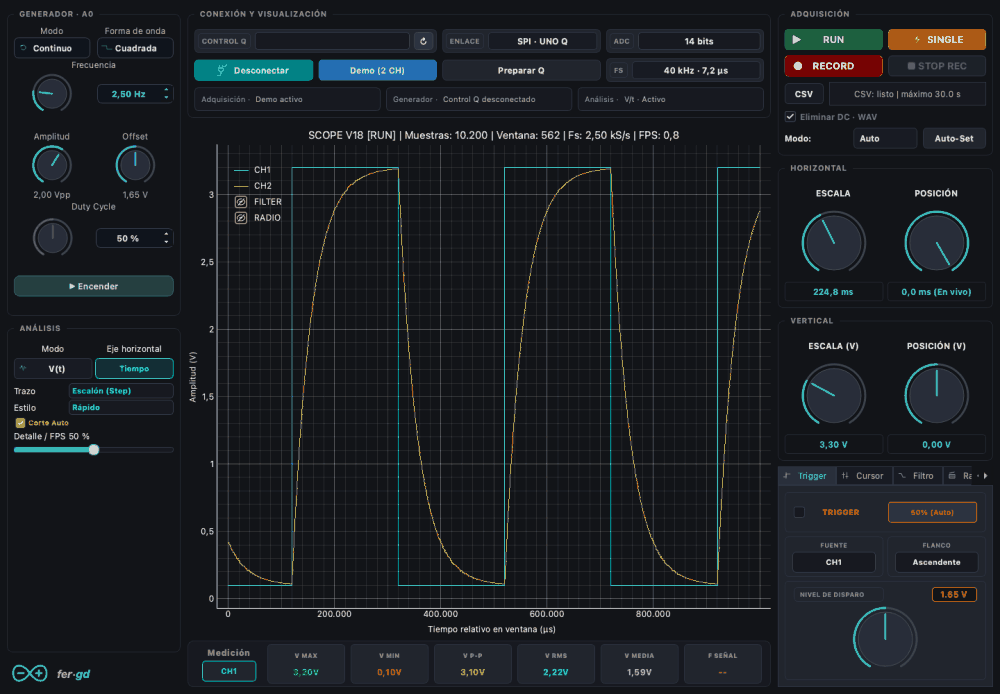
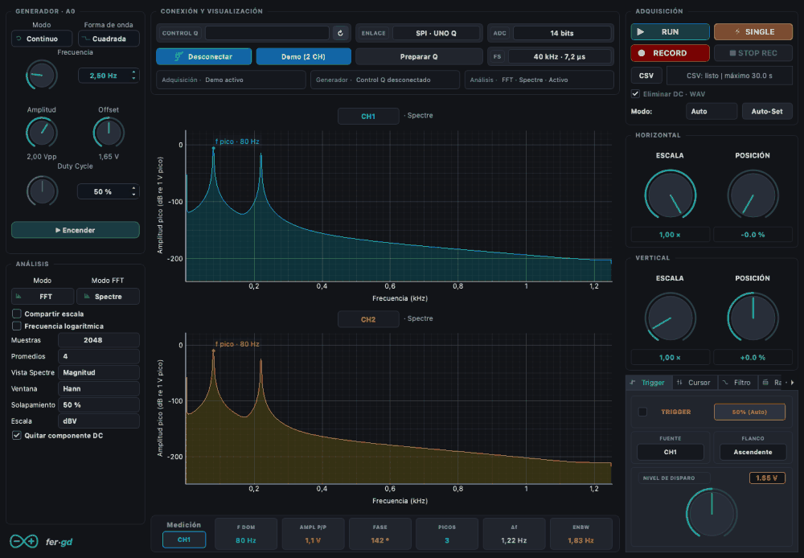
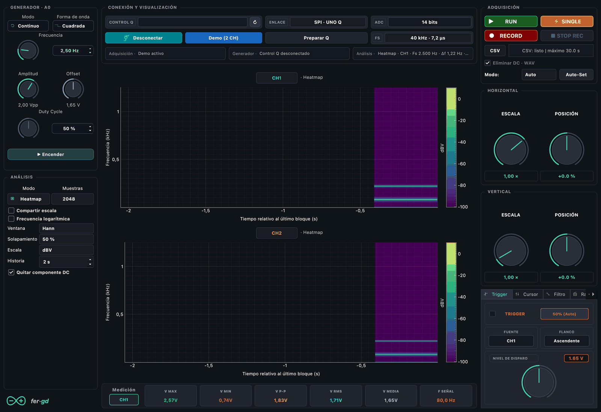
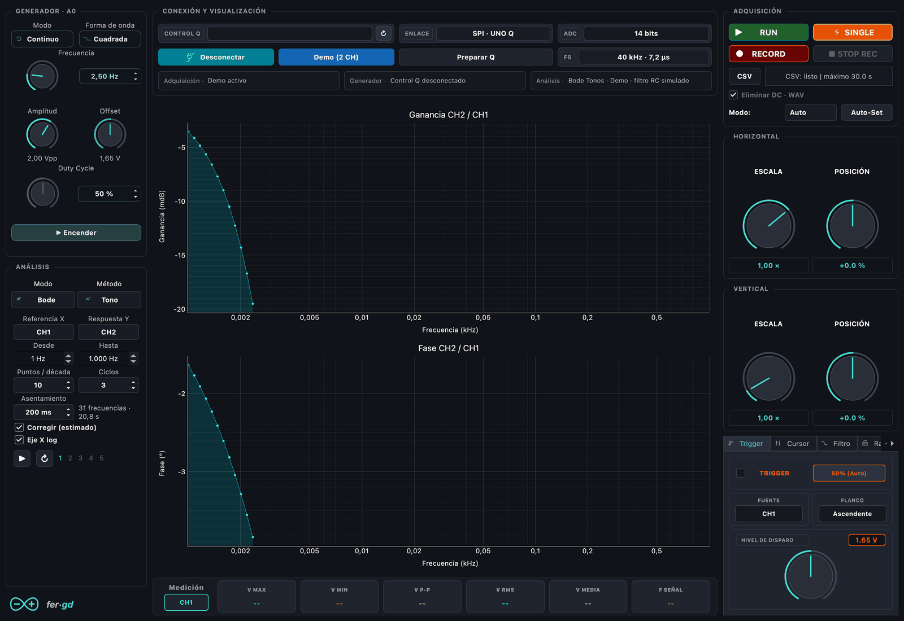
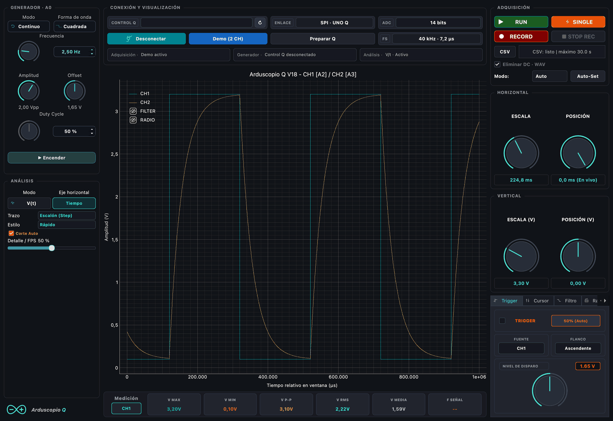
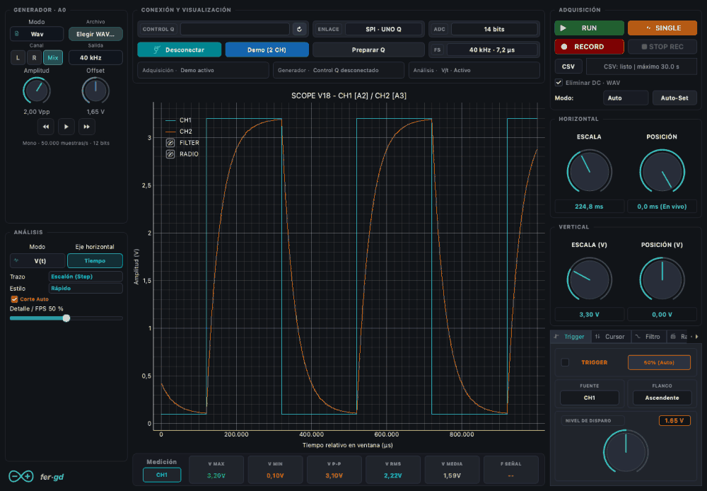
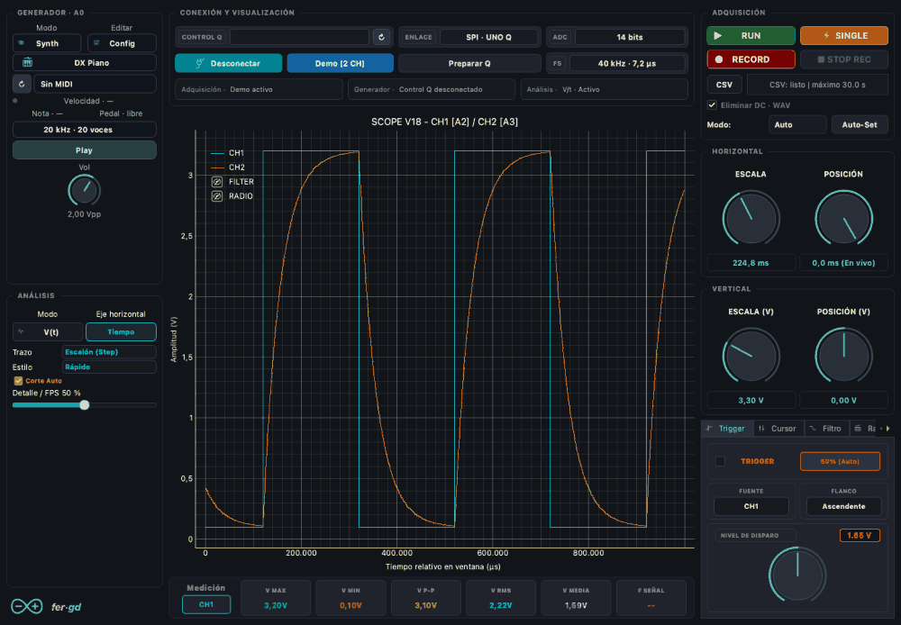
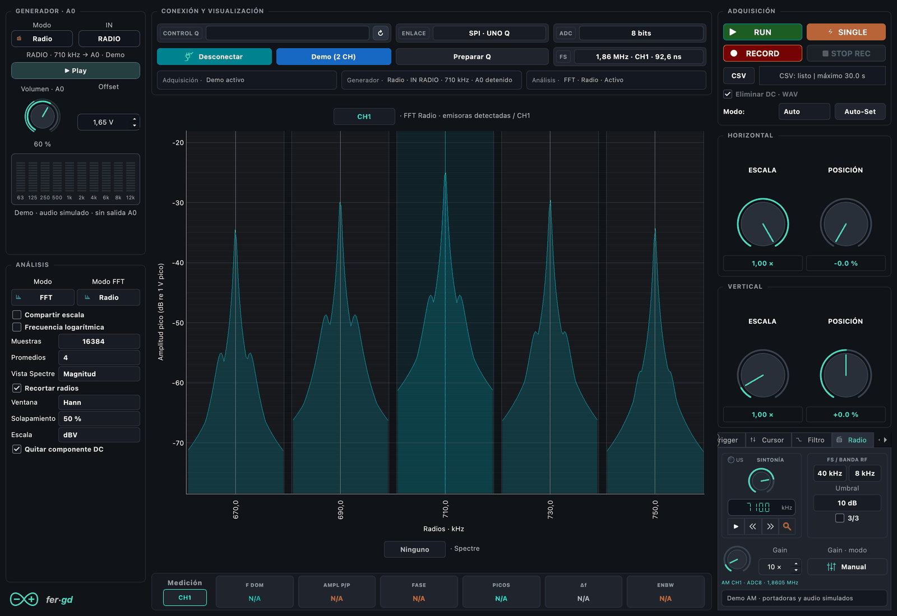
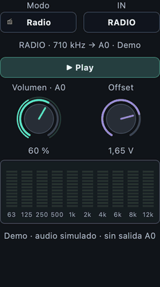
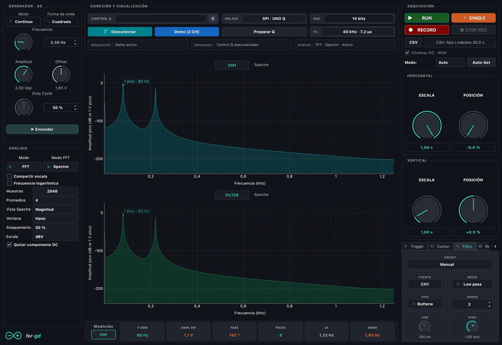

# Arduscopio Q · Osciloscopio, generador y radio AM · UNO Q

Uso gratuito **no comercial**, con cita **«Arduscopio Q, Fernando Garcia Diaz»**.
Para uso comercial, contactar al autor. [Licencia](LICENSE.md) ·
[Dependencias y distribución](licencias/TERCEROS.md).

[](https://github.com/fmgarciadiaz/SerialPythonMonitor)
[](https://github.com/fmgarciadiaz/SerialPythonMonitor/commits)
[](https://github.com/fmgarciadiaz/SerialPythonMonitor/stargazers)


Conectá un circuito y mirá cómo cambia su voltaje. Después descubrí qué
frecuencias lo componen, medí cómo responde y usá el generador para probarlo.
También podés grabar señales, escuchar audio por la salida del instrumento o
crear sonidos con el sintetizador.

El monitor de computadora, el instrumento UNO Q y un programa de enlace trabajan
en conjunto: el monitor muestra y analiza, el microcontrolador toma y genera
señales, y el enlace transporta los datos entre ambos. La interfaz está hecha en
Python; el análisis usa herramientas numéricas y el microcontrolador ejecuta
conversiones sincronizadas por hardware.

Las capturas y animaciones son demostraciones sintéticas; no acreditan
validación física. [Arquitectura del sistema](docs/ARQUITECTURA.md) ·
[Versiones, fuentes y respaldos](docs/VERSIONES.md) ·
[Plan de trabajo](Plan%20de%20trabajo.md).

## V(t) · osciloscopio

<picture>
  <source media="(prefers-reduced-motion: reduce)" srcset="assets/monitor_vt.png">
  
</picture>

[Ver imagen estática](assets/monitor_vt.png).

Conectá la entrada de un circuito y observá su voltaje a lo largo del tiempo. Escalas, posición, trigger y captura SINGLE ayudan a detenerte en la forma de onda que querés estudiar.

[Controles y detalles de V(t)](docs/GUIA_FUNCIONES.md#vt).

## FFT · espectro de frecuencia

<picture>
  <source media="(prefers-reduced-motion: reduce)" srcset="assets/monitor_fft_spectrum.png">
  
</picture>

[Ver imagen estática](assets/monitor_fft_spectrum.png).

La FFT convierte la forma de onda en una vista de sus frecuencias: así podés reconocer tonos, armónicos y cambios de amplitud. Elegí Spectrum, Power, Distortion o Transfer según qué quieras comparar.

[Controles y detalles de FFT](docs/GUIA_FUNCIONES.md#fft).

## Heatmap · evolución espectral

<picture>
  <source media="(prefers-reduced-motion: reduce)" srcset="assets/monitor_heatmap.png">
  
</picture>

[Ver imagen estática](assets/monitor_heatmap.png).

El heatmap apila espectros en el tiempo. Los colores ayudan a distinguir tonos que permanecen, barridos que se desplazan y cambios breves.

[Controles y detalles de Heatmap](docs/GUIA_FUNCIONES.md#heatmap).

## Bode · respuesta del circuito

<picture>
  <source media="(prefers-reduced-motion: reduce)" srcset="assets/monitor_bode.png">
  
</picture>

[Ver imagen estática](assets/monitor_bode.png).

Aplicá una señal conocida y compará la entrada con la salida del circuito. Bode resume cuánto cambia la amplitud y el desfase a distintas frecuencias.

[Controles y detalles de Bode](docs/GUIA_FUNCIONES.md#bode).

## Generador · señales por A0

<picture>
  <source media="(prefers-reduced-motion: reduce)" srcset="assets/monitor_generator.png">
  
</picture>

[Ver imagen estática](assets/monitor_generator.png).

Elegí una forma de onda y enviála por A0 para probar el circuito: seno, cuadrada, triángulo o rampa. También podés recorrer frecuencias o aplicar un pulso.

[Controles y detalles de Generador](docs/GUIA_FUNCIONES.md#generador).

## Wav · grabación y reproducción

<picture>
  <source media="(prefers-reduced-motion: reduce)" srcset="assets/monitor_wav.png">
  
</picture>

[Ver imagen estática](assets/monitor_wav.png).

Guardá las dos entradas como archivo de audio o reproducí un WAV por A0. Elegí canal izquierdo, derecho o mezcla; la salida del instrumento es mono.

[Controles y detalles de WAV](docs/GUIA_FUNCIONES.md#wav).

## Synth · FM, ondas y modelos físicos

<picture>
  <source media="(prefers-reduced-motion: reduce)" srcset="assets/monitor_synth.png">
  
</picture>

[Ver imagen estática](assets/monitor_synth.png).

Tocá desde MIDI o Play con un sintetizador de varias voces. Partí de ondas y presets, ajustá la modulación FM o explorá los modelos de guitarra y piano virtual.

[Controles y detalles de Synth](docs/GUIA_FUNCIONES.md#synth).

## RADIO · recepción AM y sintonía

<picture>
  <source media="(prefers-reduced-motion: reduce)" srcset="assets/monitor_radio_710.png">
  
</picture>

[Ver imagen estática](assets/monitor_radio_710.png).

<picture>
  <source media="(prefers-reduced-motion: reduce)" srcset="assets/monitor_radio_equ.png">
  
</picture>

[Ver imagen estática](assets/monitor_radio_equ.png).

Usá CH1 para recibir una señal AM, explorar la banda y sintonizar una portadora. Generador Radio puede llevar el audio demodulado a A0; las imágenes son simulaciones.

[Controles y detalles de Radio](docs/GUIA_FUNCIONES.md#radio).

## FILTER · procesamiento y comparación

<picture>
  <source media="(prefers-reduced-motion: reduce)" srcset="assets/monitor_filter.png">
  
</picture>

[Ver imagen estática](assets/monitor_filter.png).

Compará una entrada con su versión filtrada y elegí qué canal o audio procesar. FILTER puede alimentar también Generador Radio; en OFF no aplica procesamiento.

[Controles y detalles de FILTER](docs/GUIA_FUNCIONES.md#filter).

## Cómo trabajan juntas las tres partes

El monitor de la computadora presenta las señales y ofrece los controles de
análisis, grabación y generación. El microcontrolador del UNO Q mide las
entradas A2 y A3 y produce la salida A0. Entre ellos, el sistema Linux del Q y
su programa de enlace llevan las muestras y las órdenes.

Conectá las masas y llevá la señal que querés observar a A2/CH1; A3/CH2 sirve
como segundo canal. A0 es la salida del generador. Las entradas y la salida
comparten el rango nominal de 0 a 3,3 V.

[Cómo empezar](#empezar) · [Arquitectura y flujo de datos](docs/ARQUITECTURA.md) ·
[Detalles del monitor](docs/MONITOR_TECNICO.md) · [Cableado del UNO Q](docs/UNO_Q_TECNICO.md) ·
[Enlace de datos](docs/TRANSPORTE_TECNICO.md).

## Empezar

Se requiere Python 3.13 y Conda. Desde la raíz del repositorio:

```sh
conda env create -f monitor/v20/environment.yml
conda activate Python_3_13_DataScience
python -m monitor.v20 --gui
```

Demo permite recorrer la interfaz sin conectar una placa. Para usar el UNO Q,
consultá la [guía de conexión y preparación](monitor/v20/README.md) y la
[documentación de versiones y respaldos](docs/VERSIONES.md). Las tasas y modos
dependen de la configuración y de la evidencia disponible; las capturas de esta
página son sintéticas.

Si el flujo se detiene y ya no permite conectar, consultá
[cómo restablecer el Q](docs/V20_RESTABLECER_Q_20261105.md).

## Carpetas

| Carpeta | Contenido |
|---|---|
| [monitor](monitor/README.md) | Aplicación Python y receptor del PC |
| [arduino](arduino/README.md) | Sketch MCU, app MPU y relay de cada pareja |
| [transport](transport/README.md) | Herramientas y contratos de transporte compartidos |
| tools | Instalación, compilación y administración del Q |
| [docs](docs/README.md) | Guías técnicas e historia |
| [diagnosticos](diagnosticos/README.md) | Ensayos, informes y resultados físicos |
| [capturas](capturas/README.md) | Grabaciones e inventario de limpieza |
| audios | Archivos de audio para reproducción |
| [respaldos](respaldos/README.md) | Copias de fuentes y aplicaciones del Q |
| experimentos | Variantes aisladas y evidencia de desarrollo |

Las fuentes históricas se conservan en las carpetas `historico` de cada módulo.
Los entornos locales y cachés no forman parte de las fuentes.

## Documentación y validación

[Índice técnico](docs/README.md) · [Plan de trabajo](Plan%20de%20trabajo.md) ·
[Continuación](%23%20Continuar%20desde%20donde%20quedaste.md) ·
[Validación y límites](docs/VALIDACION_CIERRE.md) · [Ensayos WAV](docs/WAV_TASAS.md).

## Versiones y documentación

[Versiones, respaldos pareados y fuentes archivadas](docs/VERSIONES.md) ·
[Documentación técnica](docs/README.md) · [Historia del proyecto](docs/HISTORIA.md) ·
[Plan de trabajo](Plan%20de%20trabajo.md).
