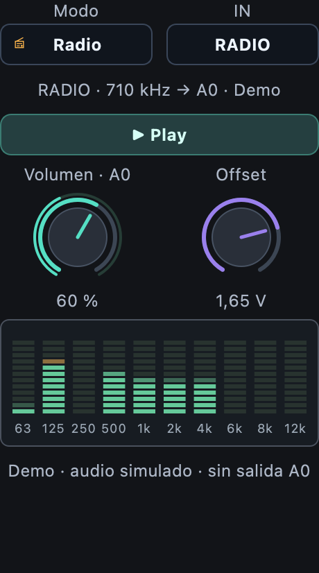

# Arduscopio Q V18: uso y límites

Arduscopio Q V18 reúne osciloscopio, FFT, heatmap, Bode, FILTER, RADIO, generador, WAV y
Synth de veinte voces. [Presentación e imágenes](../README.md).

El nombre visible de la aplicación es **Arduscopio Q**. La app del Q conserva
el identificador técnico **Scope V18**, sus rutas y hashes aceptados; el nombre
del repositorio y los comandos `monitor.v18` también se conservan.

## Inicio y Preparar Q

Ejecutar `python -m monitor.v18 --gui`. Seleccionar el Q por USB.
«Preparar Q» verifica la pareja aceptada y diez segundos de adquisición. Si ya
coincide, no vuelve a instalarla. Puede recuperar una pareja aceptada detenida
y actualizar una instalación existente mediante respaldo completo y rollback.
No actúa mientras el monitor adquiere ni reemplaza otras apps activas.
En una placa sin Scope V18, «Preparar Q» también realiza la primera instalación:
comprueba el destino vacío, compila y verifica el firmware aceptado, importa
Scope V18 y arranca su relay. Sólo confirma éxito después de comprobar identidad,
fuentes y diez segundos de adquisición continua. «Conectar» sólo abre la pareja instalada.

La placa debe tener el sistema UNO Q operativo, ADB autorizado, App CLI y el
entorno Arduino del firmware aceptado. La versión y el hash de App CLI se
verifican contra el entorno validado; si difieren se informa el problema antes
de instalar. No reinstala el sistema operativo ni instala controladores del PC.
La compilación o App CLI pueden requerir conexión a Internet para sus dependencias.

No sobrescribe una V18 parcial, otra carpeta con el mismo destino ni apps
desconocidas. Una app o relay ajeno activo debe detenerse antes. Una V17 detenida
puede permanecer instalada. Si falla después de importar, intenta detener sólo
los recursos nuevos propios y conservar sus fuentes en una carpeta de diagnóstico;
si la detención falla no mueve la carpeta. No puede restaurar un firmware inicial
desconocido de una placa sin pareja previa. El informe indica cualquier fallo de
limpieza antes de reintentar. La ruta nueva tiene pruebas automatizadas; la
primera instalación sobre un Q realmente vacío aún requiere validación física.

El soporte del botón vive en `monitor/v18/q_support`, con recibo, binarios y
verificadores propios. No usa herramientas ni módulos de versiones anteriores.
Su firmware fuente está en la pareja `arduino/v18`.

## Adquisición y análisis

CH1 utiliza A2; dual utiliza A2/A3. ADC8 CH1 alcanza 1.860.465,116 S/s reales
(88 ticks), con IPC compacto automático. Los máximos públicos restantes son
10 bits: 1,355932 MS/s; 12 bits: 1,103448 MS/s; 14 bits: 1000,000 kS/s.
ADC16 por oversampling alcanza 150,943 kS/s en CH1 y 76,227 kS/s por canal en dual. Las tasas son
muestras, no ancho de banda analógico ni precisión efectiva garantizada.
V(t) conserva trigger/SINGLE; FFT y heatmap analizan los canales seleccionados.
Bode compara referencia y respuesta: conectar la referencia real del circuito.

## RADIO y FILTER

La sintonía se limita según Fs. US extiende el dial y calcula el alias; su tramo
extendido tiene color distinto. Scan pausa las salidas necesarias y restituye
la configuración. El ancho AM inicial es 8 kHz. El gain manual/auto alcanza
80×; el ajuste automático es gradual salvo clipping extremo. Valores iniciales:
gain 10× y volumen A0 60%. FILTER tiene su propia entrada, band reject y presets.
Generador Radio puede tomar RADIO o FILTER y mantiene detector de realimentación.

### Indicadores de audio del Generador Radio

[Simulación AM a 710 kHz con FFT recortada (animación)](../assets/monitor_radio_710.gif)
· [Captura estática](../assets/monitor_radio_710.png). Generada con la interfaz V18 y
portadoras/audio sintéticos, sin conexión al Q. Las marcas ilustran emisoras
para mostrar el recorte; no representan un Scan real.

El arco exterior del volumen y las diez barras siguen el audio de la entrada
seleccionada (RADIO o FILTER), escalado por el volumen. Las bandas están centradas
en 63, 125, 250, 500 Hz y 1, 2, 4, 6, 8 y 12 kHz. Son indicadores visuales de nivel,
no controles de ecualización. Una banda sin contenido permanece apagada; el ancho
AM elegido limita el contenido de audio disponible.

El espectro usa una ventana de 2.048 muestras de audio, independiente de la FFT
principal, con cálculo limitado a unos 13 Hz y suavizado visual de hasta 30 FPS.
Sólo calcula con el panel visible y audio reciente; no guarda un historial de
mediciones. Estos valores son límites de actualización, no FPS garantizados con
adquisición y A0. La medición local anterior al suavizado dio 1,8 ms de CPU de
mediana incluyendo dibujo; no equivale a una validación física concurrente.

[Animación breve del panel](../assets/monitor_radio_equ.gif), generada con audio
sintético para mostrar su presentación. El PNG queda como alternativa estática
para lectores que no reproducen animaciones.

En FFT Radio, «Recortar radios» agrupa las emisoras detectadas en columnas,
omitiendo los intervalos entre ellas. Un clic dentro de una columna sintoniza su
portadora. Las etiquetas verticales se espacian según el zoom y el ancho visible;
con dos gráficos activos se reparte el alto en partes iguales. La anotación de
pico se oculta en esta vista. En las mediciones, F DOM identifica la componente
dominante y AMPL P/P muestra el doble de su amplitud pico.

## Generador, WAV y Synth

Salida A0 nominal de 0–3,3 V, con amplitud y offset dentro de ese rango.
Seno hasta 150 kHz y cuadrada hasta 200 kHz; frecuencias intermedias disponibles.
WAV reproduce archivos de entrada; los audios de ejemplo están en `audios/`.
Las grabaciones nuevas del monitor se guardan en `capturas/v18/`.
Synth admite veinte voces, MIDI, FM y modelos físicos.

## Evidencia y estabilidad

[Validación V18](VALIDACION_V18.md) distingue pruebas locales, transporte,
ensayos conjuntos, dibujo y restauración. Los últimos tres recorridos instalados
de 120 s aprobaron RADIO/A0, Scan, WAV y Synth20 a ADC8/1,818 MS/s. Los cortes
anteriores permanecen registrados; no es una garantía universal o analógica.
[Organización y limpieza](ORGANIZACION_V18.md).

## Cursores

La solapa Cursor permite medir con A/B en V(t), FFT, heatmap y Bode.
Ver [controles, unidades y uso con mouse](CURSORES_V18.md).
