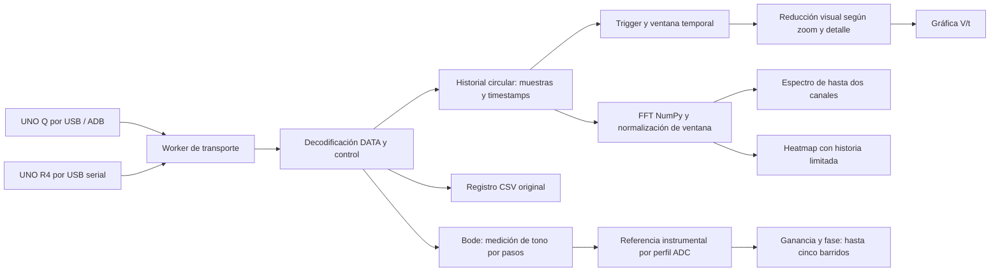
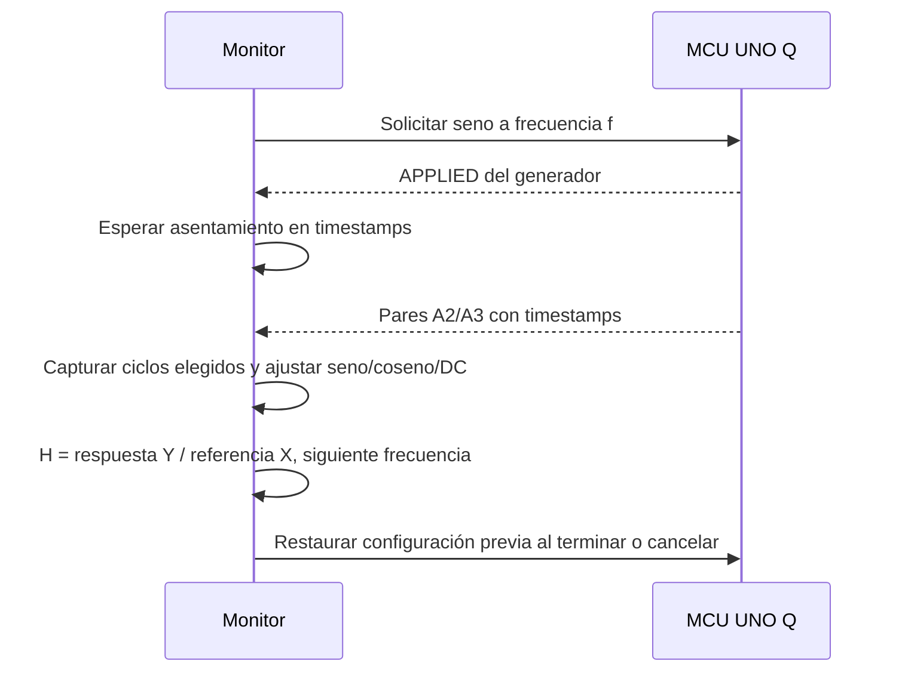

# Arduscopio Q · funcionamiento técnico

[Arquitectura completa del sistema](ARQUITECTURA_V18.md)

[Proyecto](../README.md) · [Uso del monitor](../monitor/v18/README.md)

## Flujo de datos

La interfaz y sus temporizadores pertenecen a Qt; la recepción se realiza en el
proceso receptor de V18, separado de la GUI. Los canales se identifican como
CH1 (A2) y CH2 (A3); el historial conserva índice y tiempo de las muestras.
El CSV registra las muestras adquiridas sin aplicar la reducción de dibujo.
La frecuencia real se deriva de timestamps; FPS describe dibujo, no adquisición.

## Componentes del monitor

| Archivo | Responsabilidad |
|---|---|
| [app.py](../monitor/v18/app.py) | Ventana, recepción, historial, trigger, controles, CSV y generador |
| [spectrum.py](../monitor/v18/spectrum.py) | FFT, heatmap, ejes y escalas estables |
| [bode.py](../monitor/v18/bode.py) | Barrido, asentamiento, ajuste de tono, comparación y restauración |
| [bode_calibration.py](../monitor/v18/bode_calibration.py) | Lectura de referencia y corrección sin extrapolar |
| [receiver](../monitor/v18/receiver/README.md) | Recepción, protocolos y conexión USB/ADB en el PC |
| [wav_source.py](../monitor/v18/wav_source.py) | Lectura, selección de canal y remuestreo de audio |
| [audio_dc.py](../monitor/v18/audio_dc.py) | Eliminación DC continua para grabación WAV |

## Bode y calibración

La referencia X y la respuesta Y son seleccionables; normalmente se usa
CH1 (A2) como referencia y CH2 (A3) como respuesta. El ajuste usa las entradas
adquiridas y sus tiempos. La salida nula es
válida: ganancia −∞ dB y fase indeterminada. Una referencia A2 inválida impide
formar el cociente. La fase también puede quedar indeterminada por incertidumbre.
Las curvas tienen marcadores y relleno translúcido, sin modificar resultados.

La calibración resta ganancia en dB y fase de la referencia medida conectando
A0 a ambas entradas. Interpola en log(f), sólo dentro de su rango y con los
mismos bits/tasa. Los datos internos permanecen originales; la corrección es
visual. Cada curva añadida conserva el perfil con el que fue adquirida.

## FFT, heatmap y dibujo

El monitor actual ofrece Spectrum, Power, Distortion y Transfer.
[Algoritmos, unidades y límites](FFT_ANALISIS.md) ·
[Motor numérico](../monitor/v18/spectral_analysis.py).

La representación espectral conserva los siguientes criterios.

FFT unilateral con amplitud pico normalizada por ganancia coherente de la
ventana; DC y Nyquist no se duplican. Se puede mostrar dBV o voltios pico.
El heatmap limita historia y trabajo por cuadro; las discontinuidades dejan
huecos. FFT puede enlazar escalas y usa margen e histéresis para evitar saltos.
El relleno llega al límite inferior de amplitud en dBV o a cero en voltios.

[Opciones actuales](GUIA_V18.md) · [Criterios históricos V10](FFT_V10.md) ·
[Pruebas](../tests) · [Evidencia de Bode](../diagnosticos/BODE_V10.md)

## Audio y sintetizador

[Wav: grabación y reproducción](../README.md#wav--grabación-y-reproducción) ·
[Synth: FM y modelos físicos](SYNTH.md) ·
[Guía actual del monitor](../monitor/v18/README.md).
