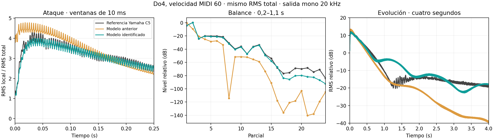

# Piano Virtual: ajuste contra grabaciones

[Monitor](../monitor/historico/v15/README.md) · [Estado del arte](PIANO_ESTADO_DEL_ARTE.md) ·
[Parámetros físicos](PIANO_PARAMETROS.md)

## Referencias y métodos

Se descargaron siete grabaciones pequeñas de Salamander Grand Piano V3,
un Yamaha C5 grabado por Alexander Holm: Do3/Do4/Do5 a intensidad media,
Do4 suave/fuerte y dos referencias reservadas para evaluar interpolación.
Se conserva [atribución, licencia y procedencia](../diagnosticos/referencias_piano/ATRIBUCION.md).

Se consultaron [Bank et al.: revisión de síntesis física de piano](https://home.mit.bme.hu/~bank/publist/jasp03.pdf),
[Bank/Sujbert: síntesis conmutada y separación de martillo/tabla](https://www.dafx.de/paper-archive/2002/DAFX02_Bank_Sujbert_piano_synthesis.pdf),
y [Simionato/Fasciani: parciales, transitorio y ruido aprendidos de grabaciones](https://arxiv.org/abs/2409.06513).
Estos trabajos motivan identificar pérdidas y radiación desde datos y evaluar
el ataque por separado; no se copió un motor externo ni el algoritmo de Pianoteq.
[OpenPiano](https://github.com/michele-perrone/OpenPiano) y
[el ejemplo modal de Podrazka](https://github.com/danielpodrazka/piano)
son ejemplos públicos para contrastar arquitecturas, no garantías de realismo.

## Qué cambió

El preset Piano Virtual usa [coeficientes identificados](../monitor/historico/v15/piano_identificado.json):
rigidez efectiva, posición efectiva del golpe, balance de los primeros 32
parciales, pérdidas por parcial, ancho de unísono, polarizaciones y crecimiento
acústico inicial. Son parámetros de un modelo reducido, no una medición única
de la mecánica del Yamaha. Por ejemplo, posición efectiva también puede
compensar errores de la excitación/radiación del prototipo.

La tabla se interpola entre Do3, Do4 y Do5 y entre tres intensidades de Do4.
Fuera de esas anclas se conserva la corrección del extremo: es extrapolación
del ajuste, sin validación acústica de todo el teclado. Los controles de
posición, rigidez, brillo y pérdidas siguen actuando sobre el modelo.

Los archivos de audio no se cargan al tocar. El render conserva contacto de
martillo, modos de cuerda y puente pasivo, con los coeficientes identificados.
La curva de crecimiento inicial es una aproximación acústica empírica, distinta
del ADSR editable; no resuelve por sí sola la interacción completa tabla–aire.
El perfil pequeño se carga en warmup; interpolaciones se cachean por nota y
velocidad. Sin el perfil se conserva la ruta física previa.

## Ensayos y selección

Se comparan notas de cuatro segundos a 20 kHz, mono. Se detecta el comienzo,
se ajusta la afinación de la referencia a la nominal y se iguala RMS. El
script estima B desde picos bajos y hace búsquedas offline de posición,
batimientos, mezcla de polarizaciones y crecimiento inicial; después ajusta
color y pérdidas por parcial en veinte iteraciones.

Se guarda el mejor checkpoint medido, no automáticamente el último. La
puntuación combina balance de parciales, pendiente de caída, envolvente de
ataque y evolución temporal. Es una métrica diagnóstica, no una prueba
perceptual. El nivel RMS del preset anterior se conserva para evitar una
reducción de volumen como explicación aparente de la mejora.

| Caso | Balance antes → después | Error de pendiente antes → después |
|---|---|---|
| Do3, velocidad 60 | 26,94 → 0,27 dB | 9,67 → 1,55 dB/s |
| Do4, velocidad 60 | 11,81 → 0,32 dB | 9,20 → 0,98 dB/s |
| Do5, velocidad 60 | 18,23 → 0,03 dB | 16,77 → 0,35 dB/s |
| Do4, velocidad 48, reservada | 10,95 → 0,78 dB | 9,64 → 1,30 dB/s |
| Re♯4, velocidad 60, reservada | 10,67 → 4,81 dB | 8,16 → 2,35 dB/s |

El balance es el error medio absoluto de amplitud de parciales activos,
quitando el nivel global. No representa el error de toda la señal: ruido,
fases, transitorios y resonancias fuera de esas bandas pueden diferir mucho.
El ataque de Do3 no mejora en todas las métricas; no se declara que cada
componente o registro sea equivalente al instrumento real.



Escucha Do4 con volumen igualado:
[referencia](../diagnosticos/resultados_piano/identificacion/C4v8_referencia.wav) ·
[anterior](../diagnosticos/resultados_piano/identificacion/C4v8_antes.wav) ·
[ajustado](../diagnosticos/resultados_piano/identificacion/C4v8_ajustado.wav).

[Resultados completos](../diagnosticos/resultados_piano/identificacion/resultados.json) ·
[Validación reservada](../diagnosticos/resultados_piano/identificacion/validacion_reservada.json).

## Rendimiento y reproducción del ensayo

Nueve voces, bloques de 480 muestras y tres segundos de audio: P95 de render
aproximadamente 1,90 ms a 20 kHz y 2,62 ms a 40 kHz. El primer bloque tomó
7,31/6,97 ms. Se observó un máximo de 31,92 ms a 40 kHz: no se presenta esa
tasa como estable en tiempo real. Son mediciones locales sin Q ni GUI;
la cola de transporte y la latencia MIDI→DAC no se modificaron ni midieron.

Las pruebas V15 comprueban continuidad, pasividad, amortiguamiento, cambios
de ruta y fallback; no sustituyen escucha con el instrumento ni medición física.

Con el entorno Python del proyecto y `ffmpeg` disponible para el diagnóstico:

```sh
python diagnosticos/ajustar_piano_referencia.py
python diagnosticos/comparar_identificacion_piano.py
python diagnosticos/comparar_piano_v15.py --before-model diagnosticos/resultados_piano/modelo_previo.py
python -m unittest discover -s tests/v15
```

El primer comando regenera el perfil del preset y los A/B. La reproducción
Synth no necesita ffmpeg, FLAC, conexión a Internet ni esos scripts.

Quedan pendientes radiación medida, fases y acoplamiento entre teclas,
repetición sobre vibración residual y una evaluación perceptual más amplia.

Detalles del [ataque, golpes repetidos y sala](PIANO_ATAQUE.md).
