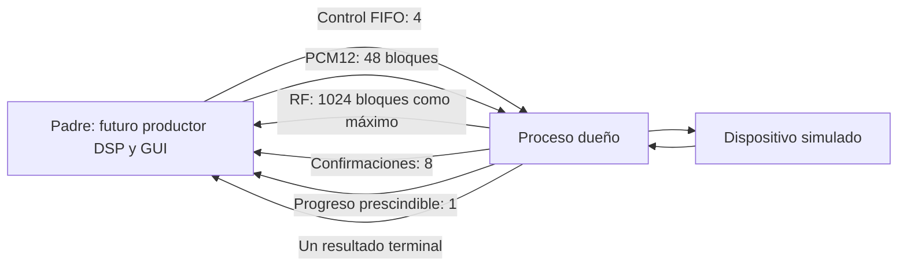

# Transporte en proceso separado: prototipo offline para V18

El objetivo es comprobar un contrato de IPC acotado antes de escribir un
backend que abra el Q. Hay dos recorridos de prueba: el contrato inicial con
SimDevice y el nuevo ProcessAudio con AudioPump/decoder real frente a un
LocalTransport simulado. **Ninguno abre USB/ADB ni conexiones al Q, usa Qt o
genera audio físico.** Las pruebas de muerte del padre usan sockets Unix
locales exclusivamente para transferir descriptores de observación.
El RF siempre es sintético: ProcessAudio puede integrar ADC/configuración
con rf_enabled=True; por defecto conserva el recorrido de audio solamente.



## Contrato implementado

- Un proceso `spawn` posee el backend. El padre no accede al dispositivo.
- Control con secuencia estricta: CONFIG, BEGIN, PLAY, STOP y SHUTDOWN.
  CONFIG sólo se admite sin sesión activa; el modelo acepta ADC8/1,6 MHz y
  audio de 40 kHz. No es una matriz de perfiles hardware.
- BEGIN exige una época creciente y sesión válida. Audio lleva época,
  sesión, offset exacto y bytes inmutables PCM12, como máximo 480 puntos.
  Un salto/repetición o una identidad incorrecta provoca fallo explícito.
- PLAY exige al menos 960 muestras confirmadas en el modelo; es un mínimo
  de prueba, **no el prebuffer público de RADIO**.
- Los créditos sólo cambian con ACK o QUERY confirmado por el backend
  simulado. Los envíos sin confirmar reservan plazas. ACK duplicado/desconocido
  o contradictorio no crea créditos; perder un ACK vence a los 500 ms.
- STOP puede adelantarse al audio que espera créditos. Cancela la época
  anterior; los ACK atrasados no pueden acreditar la sesión nueva.
- RF conserva orden y contador uint32. Si su cola se llena, el dueño falla y
  restaura el modelo; no omite bloques para continuar aparentando integridad.
- Con padre vivo, el cierre devuelve las muestras RF ya admitidas y drena los
  buffers antes de salir. Un canal de vida separado detecta EOF; también se
  comprueba el sentinel del padre. Si murió, el dueño restaura el modelo y
  sale sin esperar un consumidor RF inexistente: el resultado declara
  `abandon_on_parent_loss`. En ese caso puede quedar RF admitido sin entregar;
  no se afirma integridad ni continuidad después de la muerte del consumidor. El resultado terminal informa fallo/restauración del modelo y los
  bloques de audio cancelados. Sólo el progreso diagnóstico puede omitirse.

Las colas son limitadas: control 4, audio 48 bloques de hasta 960 bytes y un
bloque retenido por el dueño, confirmaciones 8, progreso 1 y RF hasta 1024
bloques sintéticos de 864 muestras. A 1,6 MS/s son unos 553 ms de retención RF.
El dispositivo simulado tiene 30 bloques DAC y hasta 64 respuestas pendientes.
Cada vuelta produce como máximo 32 bloques RF para no monopolizar el control;
si necesita recuperar atraso, continúa en la siguiente sin saltar índices.

## Validación

Usar el Python 3.13 del proyecto:

```sh
python -m unittest experimentos.radio_io_process_v17.test_prototype
python experimentos/radio_io_process_v17/validate_offline.py
```

La segunda orden ejecuta cinco baterías con procesos nuevos y archiva fuentes,
hashes e informes. Incluye:

- Padre bloqueado mediante una llamada C que conserva su GIL durante 350 ms:
  el proceso dueño sigue avanzando y RF se recupera sin huecos.
- Consumo DAC **simulado** durante otro bloqueo del padre de 250 ms.
- STOP con DAC lleno y datos esperando créditos; ACK atrasado de otra época.
- ACK perdido, ACK duplicado/contradictorio, QUERY no serializado, PLAY
  prematuro, offset incorrecto y CONFIG durante sesión activa.
- Consumidor RF detenido: fallo explícito y restauración exacta del modelo.
- Cierre idempotente, drenaje RF y límites del payload de audio.

[Última validación: cinco baterías de 119 pruebas, todas pasan](resultados/20261021_224010/report.json).
Los archivos `trial_1.txt` a `trial_5.txt` guardan los casos y el resultado de
cada batería; el mismo directorio conserva las tres fuentes y sus hashes.

Esto demuestra separación de intérpretes y comportamiento del contrato en
esta simulación. **No demuestra que el audio real deje de cortarse**, ni mide
la latencia USB/ADB o la holgura ADC. El backend usa respuestas de control y
QUERY simuladas sin el protocolo asíncrono real; no extrapolar su cadencia.

## Antes de conectar un backend real

1. Integrar en el futuro adaptador GUI el contrato RF ya probado: cada bloque
   lleva generación y ordinal global; CONFIG confirma la generación y la
   cantidad de bloques admitidos antes del cambio. `RfBarrier` publica la
   configuración sólo al consumir hasta esa barrera. Si RF llega antes de su
   confirmación, el llamador retiene ese único bloque y atiende control antes
   de reintentarlo; el gate no almacena bloques ni descarta muestras.
   Las pruebas fuerzan ambos órdenes entre colas, cambios con RF pendiente,
   rechazo de huecos/repeticiones y continuidad al desbordar uint32.
   Esto todavía no está conectado a la GUI ni al decoder real.
2. Integrar el journal local ya probado con el decoder real. Las respuestas
   simuladas ahora sólo traen sesión/RID y contadores, sin época IPC.
   `RequestJournal` conserva hasta 256 pedidos pendientes y 256 retirados.
   STOP retira los pendientes como cancelados; sus respuestas no acreditan
   sesiones nuevas, aunque se reutilice el número de sesión. Duplicados de
   pedidos completados, identidades contradictorias y RID desconocidos fallan.
   Una respuesta cancelada fuera del historial acotado también falla: nunca
   se adivina su dueño. Los RID no se reutilizan durante la vida del proceso;
   llegar al límite uint32 falla y exige un cierre/reinicio controlado.
   Esto valida el contrato local, no la integración SCP1 real.
3. Integrar el decoder estricto y los ACK/control asíncronos existentes,
   respetando sus límites y sin crear créditos por reloj o por telemetría.
4. Integrar estos fallos con el backend real antes de usar Q. El modelo ya
   prueba desconexión después de enviar un chunk sin inventar ACK, fallo de
   restauración y ambos errores juntos. El resultado conserva `error` y
   `restoration_error` por separado; cualquier fallo de restauración fuerza
   `reason=fault` y `restored=false`, incluso durante SHUTDOWN normal. Ya pasan EOF del canal de vida, payload inesperado y muerte real
   del padre con audio simulado activo; un supervisor verifica tanto el
   resultado de restauración del modelo como la salida del hijo mediante su
   sentinel. No es una prueba de desconexión USB ni de restauración Q.
   El fallback de terminación actual es sólo para procesos simulados.
5. Un único dueño real, snapshot/restauración de firmware/configuración,
   identidad y recuperación física. El backend real deberá confirmar esos
   hechos; asignar un diccionario en SimDevice no valida una restauración Q.

Producción no importa este experimento. No se modificaron ni se usaron el Q
o su firmware durante este bloque.

La prueba de muerte del padre usa sockets Unix locales de `multiprocessing`
para transferir al supervisor los descriptores de observación. En un sandbox
que impida esos sockets requiere ejecución local autorizada. El supervisor
limpia exclusivamente los semáforos creados por ese padre de prueba después
de verificar la salida del hijo; la terminación forzada del creador impide
que ejecute sus finalizadores. No cambia la gestión de recursos de producción.
La primera batería con muerte del padre pasó sus casos pero emitió un aviso
de semáforos al salir; la repetición enlazada arriba añade esa limpieza y no
emitió el aviso. Los informes anteriores se conservan como evidencia histórica.

## Destino de incorporación: V18

Por instrucción del usuario, la incorporación del proceso dueño y sus cambios
se hará en V18. V17 queda como referencia. Este directorio conserva su nombre
histórico de experimento: no significa que se integre en V17. Ver el
[plan de incorporación](../../docs/PLAN_INCORPORACION_V18.md).

## Primer puente con el protocolo real (todavía offline)

`wire_adapter.py` reutiliza `ConfigurationDecoder` y el encoder WAV de V17;
no abre transporte ni importa Qt. `ProtocolIngress` limita cada entrega a
32 tramas y sólo retiene una trama incompleta. Decodifica una trama por vez
y entrega sus eventos en orden antes de pasar a la siguiente: una llamada
ACK puede alimentar audio antes de convertir el ADC posterior. CRC, secuencia,
continuidad ADC, padding y contradicciones WAV conservan las validaciones
existentes. Un error de decoder o consumidor cierra el ingreso sin reintentar
sobre estado parcial. EOF con trama incompleta falla; EOF completo indica
transporte terminado, no reproducción exitosa.

`ChunkRequests` codifica PCM12 y correlaciona respuestas usando el journal.
El namespace WAV real es 0x80000000 a 0xfffffffe, distinto del modelo inicial;
el journal ahora permite configurar rango y nunca emite el valor reservado
0xffffffff. Cancelación/ACK viejo se prueban con tramas SCP1 reales construidas
localmente. Nueve pruebas nuevas cubren fragmentación y mezcla ADC/ACK,
servicio del callback antes de decodificar el siguiente ADC, errores/EOF,
cancelación, codificación y agotamiento del rango.

El validador archiva también fuentes/hashes del receiver de producción y
el fixture usado. **No es todavía un backend conectado al proceso dueño**:
El control asíncrono y el bucle no bloqueante se añadieron después, como
se describe abajo. Ya corren en el proceso con adquisición simulada opcional;
el socket ya corre en el proceso dueño frente a un emulador TCP local;
faltan túnel/identidad, restauración física y adaptador GUI V18.

## Control asíncrono compartido por WAV y RADIO

`audio_control.py` incorpora una máquina de estados sin I/O: QUERY de
capacidades, BEGIN, CHUNK, PLAY y STOP producen paquetes; los estados sólo
avanzan con respuestas correlacionadas y validadas. La negociación admite
16/30 slots y respeta la máscara de tasas; la capacidad no puede cambiar en
mitad de una sesión. Los créditos dependen de confirmaciones, nunca del reloj.
La ventana de chunks limita pedidos sin confirmar. Los controles quedan
serializados; STOP cancela pendientes y sus ACK tardíos no reactivan audio.

Consulta inicial con session=0 puede describir una sesión remota existente:
se informa occupied y no se toma posesión automáticamente. Tras timeout,
rechazo, UNDERRUN o contradicción, el controlador queda en fallo hasta STOP.
El plazo se comprueba al recibir ACK además del tick periódico: un ACK fuera
de plazo no se acepta aunque el llamador haya demorado el tick.

Once pruebas nuevas cubren estos estados, capacidades, ventana, audio corto,
STOP/cancelación, sesión ocupada y errores. El prebuffer por defecto de 960
puntos es exclusivamente el mínimo de las pruebas, no una política pública.
El bucle local añadido a continuación envía paquetes, llama tick, programa
consultas y recibe PCM en una cola acotada. Ya está unido al proceso dueño
en el recorrido simulado descrito abajo; el adaptador SocketTransport ya
está probado con TCP local y unido al hijo; no se conectó al Q. Si un envío
falla debe llamar fail(); no hay reintentos ni restauración física aquí.
El puente aún no sustituye SimDevice ni está integrado en V18.

## Bucle no bloqueante con transporte local simulado

`audio_pump.py` une AudioControl con ProtocolIngress. Su interfaz de transporte
exige send/recv no bloqueantes; send puede completar sólo parte de una trama.
Conserva un único paquete de salida y su posición, sin duplicar bytes. Un
turno lee como máximo32tramas; los callbacks ACK pueden enviar el siguiente
paquete antes de decodificar el ADC posterior. Los callbacks externos también
deben ser acotados y no bloqueantes: todavía no hay adaptador IPC/GUI.

Cola PCM de hasta48bloques: llenarse produce queue.Full sin avanzar offset;
el productor debe reintentar ese mismo bloque. No se descartan PCM para
ocultar sobrecarga. Consulta periódica y tick no crean créditos por reloj;
si el DAC está lleno y aún hay PCM esperando, QUERY sigue pudiendo confirmar
espacio consumido. La consulta no se adelanta a pedidos pendientes.

STOP cancela la cola PCM con contador explícito. Si un paquete está parcial,
lo completa antes de enviar STOP para no romper SCP1; si está totalmente sin
enviar puede cancelarlo. BEGIN no enviado conserva la sesión remota anterior
para STOP. Hay plazo para completar la parada, incluidas escrituras bloqueadas.

Error de envío, escritura de cero bytes, timeout o EOF cierran el componente
con salida incierta; no se reintenta el paquete ni se declara restauración.
EOF con parcial conserva el error de framing del decoder. close es liberación
local, no confirmación física: para cierre normal se pide STOP y se espera
stopped. Cualquier integración deberá tratar por separado la restauración Q.

Diez pruebas nuevas usan LocalTransport determinista, sin reloj DAC ni socket:
lecturas/escrituras parciales, cola llena, STOP antes de BEGIN/en mitad de
trama, fallo/EOF/ACK perdido, límite de parada, servicio ACK antes de ADC y
QUERY con DAC lleno. El nuevo recorrido ProcessAudio descrito a continuación ya ejecuta el bucle
en spawn; esas diez pruebas directas siguen siendo exclusivamente locales.
Ninguno de estos recorridos constituye aceptación de audio real.

## Bucle de audio ejecutado en spawn

`process_audio.py` introduce ProcessAudio, que reutiliza el IPC y el cierre
acotado del contrato inicial. El hijo crea AudioPump, su decoder SCP1 y un
LocalTransport con consumo DAC modelado a40kHz por reloj monotónico. El padre
sólo envía BEGIN/STOP/SHUTDOWN y PCM. Los eventos de comandos confirman
**aceptación en el hijo**, no confirmación del Q; los estados del dispositivo
se observan por progreso, y el resultado terminal verifica STOP del modelo.
No hay comando PLAY público en este recorrido: el control de audio lo emite
al confirmar su prebuffer. CONFIG/adquisición RF se habilita con
rf_enabled=True, según la sección siguiente.

Límites: control4, entradaPCM48, cola internaPCM48, un bloque retenido, una
trama de salida parcial, eventos8 y progreso1 prescindible. LocalTransport
retiene como máximo128tramas de diagnóstico,64respuestas y una trama parcial
de entrada. Su contador total de tramas es independiente del historial.
Sin rf_enabled, la cola RF queda vacía (rf_blocks=0). Con esa opción,
AcquisitionPath publica los bloques validados por el decoder compartido.

Ocho pruebas nuevas pasan. Con48bloques ya recibidos por el hijo y audio
simulado en PLAYING, el padre conserva su GIL250ms: el hijo sigue procesando
SCP1, crece el contador de tramas y played avanza más de6000puntos. Este ensayo
usa prebuffer30bloques sólo para asegurar reserva del modelo, no cambia una
política pública. Otras pruebas cubren escrituras parciales, STOP/época nueva
con el mismo número de sesión, offset inválido, EOF del canal de vida, falta
de PCM y underrun. Matar un padre real también verifica que este nuevo hijo
confirma STOP del modelo y termina, observando su sentinel desde supervisor.

En cierre se intenta STOP a través de AudioPump y se exige respuesta IDLE;
no se fuerza un diccionario para declarar restauración. Resultado model_only
es siempre true. Si el bucle ya falló/cerró el transporte, no puede confirmar
STOP y devuelve restored=false/salida incierta, como prueba el underrun.
Esto no valida parada o restauración física ni firmware, ADC o dibujo GUI.

La adquisición/configuración simulada ya comparte el bucle mediante
AcquisitionPath. SocketTransport ya ofrece I/O no bloqueante sobre una
conexión existente y ya corre en el hijo frente al emulador local; siguen
pendientes conexión/identidad Q, restauración física y adaptador V18. El contrato original con SimDevice
se conserva como prueba independiente; no fue reemplazado por AudioPump.

## Adquisición y audio dentro del mismo hijo

`ProcessAudio(rf_enabled=True)` une AcquisitionPath al mismo decoder y al
mismo flujo SCP1 que WAV/RADIO. El peer local genera ADC14 dual sintético a
125kS/s y admite cambiarlo a40kS/s; **no modela 1,6MS/s ni todos los bits**.
Esto verifica orden de protocolo, no rendimiento o recepción analógica.

CONFIG sólo se admite con salida de audio confirmada en reposo. Usa un RID
reservado en el mismo journal que el audio, evitando colisiones entre ambos
tipos de pedido. ACCEPTED no publica cambios; APPLIED valida solicitud,
perfil y época. Su ausencia tiene plazo, y confirmaciones ajenas fallan.
Al conectarse a un flujo existente, la primera trama válida publica el perfil
inferido por el decoder como configuración inicial, con su primer índice.

Cada bloque RF lleva generación IPC, ordinal global, primer índice y una
tupla de registros (timestamp, CH1, CH2, índice). Se admiten tamaños variables
hasta904registros; la validación específica sigue en ConfigurationDecoder.
La generación RF, la época ADC del firmware y la época de audio son campos
separados. CONFIG_APPLIED lleva el número de bloques anteriores y el índice
inicial nuevo. `RfBarrier(block_size=None)` espera a drenar esa cantidad antes
de publicar el cambio y reiniciar el índice; el contrato antiguo conserva
block_size864 por defecto. No se mezclan relojes/configuraciones entre colas.

SHUTDOWN/STOP esperan un CONFIG en curso para no truncar su trama. El cierre
intenta STOP→IDLE y, si cambió ADC, solicita volver al perfil original del
modelo y espera APPLIED. No declara éxito si alguna confirmación falta. RF
lleno produce fallo explícito; si el error ya cerró el bucle, el resultado
queda sin restauración confirmada. Al morir el padre se suprime publicación
nueva durante la limpieza, contando bloques abandonados; no se bloquea STOP
por un consumidor RF que desapareció. Lo ya admitido mantiene su contador.

Diez pruebas nuevas cubren barrera con muestras viejas pendientes/reinicio de
índice, ADC+audio durante bloqueoGIL250ms, sobrecargaRF, CONFIG durante audio,
perfil fuera del modelo, muerte real del padre, cierre con CONFIG parcial,
fases ACCEPTED/APPLIED, confirmación incorrecta y plazo sin APPLIED.
En la prueba conjunta played avanza>6000puntos y RF>50bloques, sin huecos en
los bloques admitidos. El modelo se restaura aADC14/125kS/s y generadorOFF;
**no es una restauración del Q ni aceptación a1,6MS/s**.

## Adaptador de socket no bloqueante

`socket_transport.py` acepta un socket de flujo **ya conectado** y toma su
propiedad exclusiva. No busca Q, no abre ADB, no conecta/reconecta ni cambia
firmware. Pasa el socket a modo no bloqueante y habilita TCP_NODELAY en TCP.
No usa el read de Connection de V17, que espera hasta100ms; V17 queda intacta.
La apertura del túnel/identidad y su cierre siguen pendientes de integrar.

Cada send realiza una sola llamada y devuelve el número real de bytes; una
escritura parcial no se completa con sendall. recv distingue BlockingIOError
de EOF y conserva el límite32×992bytes. Se cuentan bytes admitidos/recibidos;
no hay otro buffer dentro del adaptador. Dos segundos sin datos al intentar
leer provocan timeout (reloj inyectable en pruebas); un dato nuevo renueva el
plazo. No crea créditos ni convierte silencio de transporte en audio correcto.
close es idempotente y sólo cierra el socket, sin prometer restauración Q.

Ocho pruebas nuevas usan socketpair y TCP real exclusivamente127.0.0.1:
EAGAIN/EOF, lecturas fragmentadas sin pérdida de bytes, TCP_NODELAY activado,
backpressure del kernel con escrituras parciales, límite de inactividad,
validación de conexión/límites, sesión AudioPump completa con peer fragmentado
y EOF en mitad de una trama. Esas ocho pruebas ejecutan el bucle directamente,
sin representar la conexión USB/ADB del Q. La integración posterior en spawn
se describe a continuación y tiene su propia prueba GIL.

La primera corrida local detectó dos problemas del test/peer: en este sistema
TCP_NODELAY activo devuelve un entero no nulo que no es necesariamente1, y el
peer debía conservar bytes que cruzaban el límite992 de una trama. Las
comprobaciones y el peer se corrigieron; cinco baterías completas de84pruebas
pasan sin avisos de recursos. Se conservan las fuentes e informes previos.

## TCP real en el hijo, dispositivo emulado en otro proceso

ProcessSocketAudio transfiere un socketTCP ya conectado al hijo y cierra la
copia del padre después de spawn. SocketModelPeer presenta al bucle el estado
observado en respuestas estrictamente decodificadas; no accede al estado del
servidor por memoria compartida. Sigue etiquetado model_only=true: su perfil
inicial14/125kS/s es conocido por el fixture, no un snapshot de un Q real.
Esta clase es un recorrido de pruebas locales, no una entrada para operar Q.

TcpModelServer corre en otro proceso spawn y escucha sólo127.0.0.1. Genera
RF14dual40/125kS/s y consume audio40kHz con su propio reloj monotónico.
Fracciona la escrituraTCP a619bytes por vuelta; el bucle debe rearmar SCP1.
Empieza RF con la primera solicitud del cliente para que la prueba no agote
buffers durante imports/arranque. Esto difiere del arranque físico del Q.
El padre/GUI no hospeda el emulador en un hilo que su GIL pudiera frenar.

Seis pruebas nuevas pasan. Con GIL del padre retenido250ms, el hijo con socket
real sigue recibiendoRF y confirmaciones, played avanza>6000puntos y RF>50bloques.
Se prueban barreras/reinicio de índice por CONFIG, vuelta al perfil original,
EOF antes deREADY, desconexión, respuestaACK suprimida conRF vivo y muerte
real del padre. El servidor verifica de forma independiente STOP/IDLE y perfil
original después del cierre; no basta el resultado declarado por el hijo.

READY exige configuraciónRF inicial conocida cuando RF está habilitado. Si
el servidor cierra antes, el resultado conserva generator/bits/rate=None y
restored=false; no inventa una configuración. El emulador puede suprimir una
respuesta sin asignarle número de trama para probar timeout mientras sigue
RF; no es una simulación de pérdida de un segmentoTCP. Su informe distingue
EOF/reset de conexión de errores internos y conserva el detalle del reset.

La primera corrida detectó capacidad insuficiente en la fragmentación del
servidor (113bytes/vuelta), un hueco artificial de secuencia al suprimirACK y
un acceso a configuraciónNone durante cierre previo aREADY. Se corrigieron
el fixture y el informe de estado desconocido. Cinco baterías de90pruebas
pasan con fuentes archivadas; no es aceptación de carga física a1,6MS/s.
Pendientes: abrir/cerrar el túnel con identidad, snapshot/restauración reales,
prepararV18 y unirGUI/DSP. V17 y firmware no se modificaron; Q no se abrió.

## Ciclo del túnel ADB, probado con dependencias simuladas

`adb_tunnel.py` prepara una lease explícita de reenvío. Requiere serial,
identidad esperada completa (serial/app/firmwareSHA), lector de identidad,
verificador de exclusividad y ejecutor ADB inyectados. No usa automáticamente
el lector de V17 ni abre hardware al importar. Las diez pruebas nuevas usan
FakeAdb y DummySocket: no ejecutan ADB real ni conectan Q.

open comprueba exclusividad/identidad, presenciaUSB, lista previa de forwards,
asignación tcp:0→tcp:8766 y lista posterior antes de conectar localhost.
Un fallo al conectar libera el puerto confirmado propio. Un puerto ya
existente no se adopta; si la respuesta de asignación es inválida, una entrada
nueva no se atribuye por mera diferencia y queda marcada sin resolver. Se
conservan los otros forwards. Antes de retirar el propio se compara la
entrada actual; un reemplazo diferente queda intacto y se informa.

Tras take_socket, el receptor es dueño del socket pero la lease conserva el
forward. close informa pending_owner y no retira ese forward hasta
confirm_owner_exit(True), que deberá proceder de la observación de salida del
hijo. Luego confirma la remoción por otra lectura de la lista. El lector de
identidad final sólo se admite después del cierre confirmado del forward y
vuelve a exigir exclusividad. Igualdad de identidad no demuestra que ADC o
generador hayan vuelto a su estado previo.

Todos los resultados de esta lease llevan hardware_restored=false: aún no
captura/restaura ADC, generador, relay ni firmware. Las comprobaciones ADB y
de identidad deben quedar fuera del bucle de muestras; el ejecutor real
necesitará los tiempos límite existentes. Todavía no está unido a
ProcessSocketAudio ni es una entrada de conexión física del monitor.

Las pruebas cubren identidad equivocada/ocupación, USBausente, puerto nuevo,
fallo de conexión, respuesta inválida, puerto preexistente/reemplazado,
transferencia al hijo y cambio de identidad final. Cinco baterías de100pruebas
pasan; la evidencia sigue siendo offline/modelada. Próximo: snapshot exacto
de ADC/generador/identidades y su restauración verificada antes de operarQ.

## Registro exacto y contrato de restauración

`device_snapshot.py` añade DeviceIdentity (serial/app/SHA256 de firmware y
relay), Observation y DeviceSnapshot inmutable. Guarda bits y período ADC
codificado, no sólo la tasa redondeada, y todos los campos GeneratorConfig:
onda, enabled, modo, frecuencia inicial/final, low/high, duración/unidad y duty.
Se serializa con esquema1 aJSON y rechaza versiones desconocidas o identidad
incompleta. No inventa ni consulta una identidad real al construirlo.

La captura de referencia exige SPI, WAV detenido o finalizado y generadorOFF
sin ejecución. No interrumpe una sesión ocupada para fabricar una referencia;
no captura fase de una onda activa ni estado de reproducción de un archivo.

restore_contract trabaja sobre un backend inyectado: verifica exclusividad e
identidad, pide Stop, exige IDLE y generador detenido, restaura ADC y parámetros
exactos del generador y vuelve a leer. Si falla el ADC aún intenta restituir
el generadorOFF; no declara éxito por ese intento. Exige después recuperación
de10s, continuidad, configuración exacta, cero dropped/fatal y una cantidad
de muestras compatible con la tasa descontando una cola de nodo/trama.
Una muestra aislada no acredita recuperación sostenida. Otra lectura final
confirma que el estado no cambió. El informe válido también es JSONserializable.

Nueve pruebas nuevas verifican ida/vueltaJSON, referencia ocupada/UART,
restauración exacta, identidad cambiada sin escrituras, falloADC/generador,
Stop no confirmado y recuperación inválida. Usan Backend simulado: los10s
son datos del fixture, **no10s medidos con Q**. El resultado se llama
restore_contract_ok y mantiene hardware_restored=false, aun si pasa. No hay
lector real de estado/generador/relay integrado ni comandos de firmware.

Cinco baterías de109pruebas pasan sin avisos de recursos. Antes de cualquier
prueba física falta conectar este contrato a lecturas y ACK reales en el
dueño, unir la leaseADB, persistir la referencia previa y validar en Q.
El registro no sustituye copia de firmware ni comprueba su contenido físico.

## Lectura del generador en el dueño y por TCP

GeneratorPath usa generator_request/ConfigurationDecoder existentes y el
mismo journalRID del audio/ADC. GEN_QUERY se serializa con ambos controles;
ACCEPTED no publica estado, APPLIED libera el pedido y emite
GENERATOR_READBACK con la configuración completa y running. Un RID ajeno,
rechazo, duplicado o plazo vencido no fabrica una lectura válida. Consulta
sólo en reposo; BEGIN/CONFIG no se adelantan a una consulta pendiente, y
STOP/SHUTDOWN esperan una consulta iniciada para conservar framing.

El emulador devuelve onda, enabled, modo, frecuencias inicial/final, niveles,
duración/unidad y duty desde una trama SCP1tipo9. El proceso no obtiene esos
valores por acceso directo al objeto servidor. Cuando una lectura ya conocida
indica generador activo, el inicio del experimento se rechaza. El fixture
antiguo sigue permitiendo audio sin consulta automática; no es un arranque
completo del monitor físico.

Seis pruebas nuevas verifican fases, RID incorrecto, duplicados, timeout,
consulta durante audio y lectura exacta en el hijo local/mediante TCP. Duty37,
frecuencias y niveles intermedios del fixture atraviesan encoder/decoder.
El resultado terminal conserva la lectura final posterior a Stop cuando
existe una referenciaOFF previamente consultada, marcada generator_verified.
Sin referencia o ante fallo conserva la última lectura con ese marcadorfalse;
no equivale a restauración confirmada. La extensión SET/restauración descrita
abajo todavía no incluye captura automática con identidad real antes deREADY.

Cinco baterías de115pruebas pasan sin avisos de recursos. Falta conectar
estas lecturas a DeviceSnapshot/restore_contract y la leaseADB, persistir la
referencia previa y comprobar el cierre con lectura final y recuperación
reales. No se conectóQ ni se cambió V17/firmware/aplicaciones del equipo.

## Restauración OFF y consulta independiente después de Stop

GeneratorPath permite set_off sólo después de una consulta que confirmó una
referenciaOFF. GEN_SET rechaza enabled=1 incluso antes de encolar el comando.
La confirmaciónAPPLIED debe coincidir con la configuración solicitada; no
acepta un eco de otro perfil. Se conserva la primera referenciaOFF, no se
reemplaza por los parámetros de cada modificación posterior.

En cierre, tras STOP/IDLE y restauraciónADC, el dueño vuelve a enviar la
referencia completa si cambió. Después hace QUERY con un pedido distinto,
aunque ya tenga unAPPLIED correcto. Sólo igualdad de todos los parámetros y
running=false dan generator_verified=true. Un error impide restauración
aceptada; el resultado permanece model_only=true. Sin referencia consultada
no hay verificación completa del generador y el marcadorquedafalse.
Los eventos nuevos de lectura no se publican a un padre muerto durante la
limpieza, para que un consumidor inexistente no bloquee la confirmación.

Cuatro pruebas nuevas cubren referencia ausente, APPLIED distinto, rechazo
de enabled=1 y modificación/restauración por TCP. El último caso cambia
frecuencia, niveles, duración y duty del generador deshabilitado: el hijo
restaura todos los originales y otro proceso servidor confirma la misma
configuración. Cinco baterías de119pruebas pasan sin avisos de recursos.

Este recorrido todavía no ejecuta la recuperación física de10s ni la lectura
de identidad/relay real de DeviceSnapshot. Las consultas son tramas reales
frente al emulador local; no se conectóQ ni se modificaron sus programas.
La incorporación sigue enV18 y falta unir contrato/lease y adaptadorGUI.

## Continuación en V18

El núcleo, protocolo y pruebas se trasladaron a un namespace propio de
[V18](../../monitor/v18/README.md). La copia V18 pasó122pruebas locales una
vez; no es GUI ni aceptación física. Este experimento y sus resultados se
conservan como procedencia histórica. El trabajo siguiente del candidato
continúa en monitor/v18 y tests/v18; V17 permanece como monitor de referencia.
