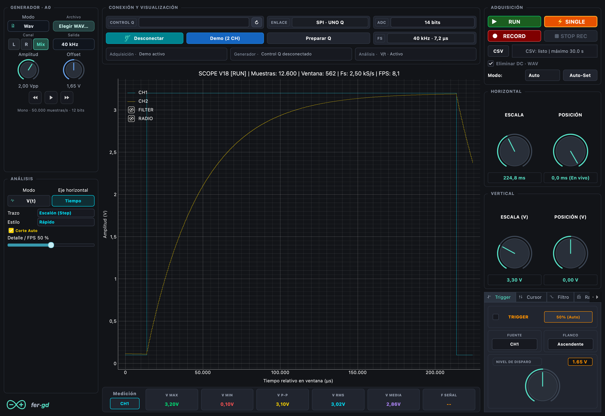
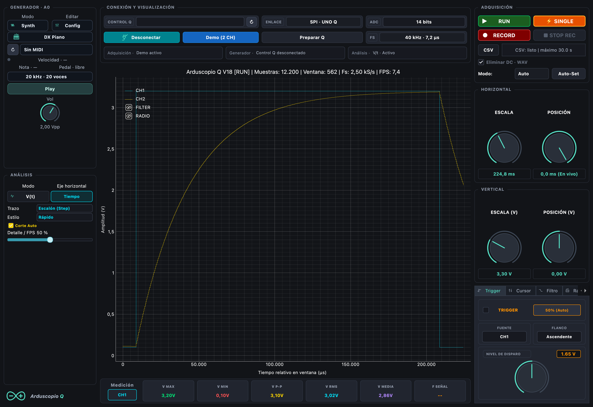

# Monitor de osciloscopio y análisis espectral

Interfaz PyQt6 para dos entradas A2/V_IN y A3/V_OUT, generador A0,
trigger/SINGLE, FFT, heatmap, Bode, grabación/reproducción CSV/WAV y mini sintetizador Synth
polifónico de nueve voces y salida mono, con controles en vivo y entrada MIDI opcional.
Esta variante conserva los protocolos, perfiles ADC y firmware del monitor anterior.

## Inicio

```sh
conda activate Python_3_13_DataScience
python monitor/historico/v15/app.py
```

Para instalar el entorno en otra computadora:

```sh
conda env create -f monitor/historico/v15/environment.yml
```

VS Code incluye tareas y configuraciones de depuración para este monitor.
Conectar verifica V13 Pulse y comprueba/inicia su app y relay cuando hace falta.
Preparar Q instala o actualiza V13 Pulse, con audio y pulsos desde 100 µs,
incluyendo app, firmware MCU y relay. Conectar requiere esa versión; no carga
fuentes automáticamente.
Antes de preparar aparece un aviso: puede tardar varios minutos. El relay se
reutiliza si ya existe el binario correspondiente a las mismas fuentes; solo se
compila cuando falta. La validación y carga del MCU y el respaldo siguen activos.
No hace falta seleccionar firmware mediante variables de entorno.

[Validación física actual y respaldos](../../../docs/VALIDACION_CIERRE.md).

## Wav · archivos y grabación



En el generador, Wav reproduce L/R/Mix del archivo por A0, con salida de
40 kHz inicial y opciones 20/40/50 kHz según firmware. Incluye Play/Stop,
flechas para saltar 10 s y amplitud ajustable. Play inicia adquisición y
bloquea cambios ADC; al finalizar queda en silencio.

El selector CSV/WAV del registro graba A2/A3 como WAV estéreo PCM16.
Eliminar DC usa un pasa altos continuo de 5 Hz, independiente por canal.
No resta la media por ventanas ni requiere una entrada centrada en 1,65 V.
Archivos con fecha/hora, duración máxima 30 s; esta implementación guarda
las capturas en `capturas/v14/`. El nombre en pantalla omite bits y tasa,
pero el archivo conserva esos datos.

[Tasas y evidencia física](../../../docs/WAV_TASAS.md) ·
[Presentación de Wav y Synth](../../../README.md#wav--grabación-y-reproducción).

## Generador Synth



Elegir **Synth** en el generador. En Osc 1, Sonido permite FM, ondas clásicas
y Virtual; Preset carga el instrumento. **DX Piano** es inicial; el nivel de
Synth comienza en 2,5 Vpp y el offset en 1,65 V. Play activa también la
adquisición. **Config** reúne MIDI, velocidad, frecuencia/voces y Play/Stop.
El editor ofrece **Config, Osc 1, Osc 2, Osc 3, ADSR, Timbre, Filtros
y Virtual**. ADSR reúne las tres envolventes.

Piano Virtual incorpora contacto de martillo con reflexiones, hasta 128
parciales, colas de unísonos, caja y resonancias simpáticas. El piano puro
usa una ruta nativa para reducir cálculo; el buffer de transporte conserva
su margen. [Modelo, comparación de audio y límites](../../../docs/PIANO_REVISION_REALISMO.md).

El preset incorpora ahora color, pérdidas y evolución identificados contra
grabaciones de un Yamaha C5, conservando la generación modal en tiempo real.
[Ajuste, referencias y comparación A/B](../../../docs/PIANO_IDENTIFICACION.md).

FM tiene parcial, amount y feedback por pareja; mezcla, detune y octava permiten
capas y batimientos. Las ondas clásicas conservan ADSR, MIDI y filtros. Virtual
ofrece **Guitarra** y **Piano Virtual**, con vibración, posición, brillo, caja,
puente y rigidez (solo piano). Brillo del piano y posición afectan el próximo
golpe/pellizco; caja, puente y pérdidas mantienen estado entre bloques.

La salida es mono PCM de 12 bits a **20 kHz por defecto**, o 40 kHz antes
de Play. MIDI admite nueve voces. El protocolo usa bloques de 480 muestras,
créditos y dos envíos Synth en tránsito. La cola mínima es 120 ms a 20 kHz
(y puede crecer) o 192 ms a 40 kHz; no incluye latencia MIDI/USB. A 40 kHz
se observaron cortes físicos: el margen de cálculo local no los descarta.
Numba 0.62.1 prepara y compila feedback, ADSR y modelos físicos antes de Play.
Sin Numba se conservan las ondas/FM sin feedback; Virtual requiere instalarlo.

[Arquitectura actual, modelos, rendimiento y límites](../../../docs/SYNTH.md).
Los apartados de evolución más abajo conservan mediciones y ajustes históricos;
la guía actual y la última revisión reemplazan esos valores anteriores.

### MIDI opcional

Las dependencias son `mido==1.3.3` y `python-rtmidi==1.5.8`, incluidas en
`environment.yml`. [API de puertos Mido](https://mido.github.io/mido/ports/index.html).
Pulsar **Actualizar MIDI** y elegir un teclado/puerto IAC o **UNO Q Synth · virtual**;
en este último caso la aplicación musical puede seleccionar la salida MIDI
**UNO Q Synth**. En modo MIDI la salida permanece en silencio hasta recibir notas.
La búsqueda y apertura MIDI se hacen en un proceso Python aislado, iniciado y
cerrado por el monitor; no requieren Swift ni instalación de un driver adicional.
El acceso nativo a CoreMIDI tiene un límite de ocho segundos y no bloquea la
ventana. Los errores se muestran en el estado y el tooltip del selector; pulsar
Actualizar MIDI permite intentar otra vez. Al actualizar se conserva la entrada
seleccionada si continúa disponible. El procesamiento de mensajes tiene límites
por turno y una cola acotada; una saturación cierra la entrada y libera las notas.
La síntesis MIDI admite **nueve voces** con envolventes independientes. Si llegan
más notas, se conservan las nueve últimas; se roba primero una voz liberada,
o la más antigua. Note Off inicia la liberación de cada voz; velocidad controla nivel, CC1 el índice,
CC7 la amplitud y CC120/123 liberan las notas. El indicador «Velocidad» muestra
el valor MIDI (1–127); también cambia el brillo de los presets. Manual
también sigue la relación M/C elegida; los instrumentos mantienen una relación de frecuencia
con la nota y reducen la modulación en registros altos para limitar el ancho de banda.
La suma usa ganancia fija y compresión gradual antes del limitador final;
no se divide el volumen por la cantidad de teclas pulsadas.

### Timbres

El selector incluye Manual, Flauta, Órgano, **DX Piano**, **DX Brillo** y **Campana**. Son aproximaciones sintéticas:
una pareja FM principal (portadora/moduladora), una segunda pareja opcional para
el brillo, envolvente de amplitud y evolución del índice. Flauta tiene ataque suave y sostenido; Órgano añade armónicos sostenidos;
DX Brillo tiene ataque breve y decaimiento de amplitud/brillo incluso con la tecla
mantenida. Note Off inicia la liberación, evitando cortar la onda de golpe.
Se basan en el esquema de [operadores y envolventes explicado por Yamaha](https://usa.yamaha.com/products/contents/music_production/synth_50th/anecdotes/004.html);
los parámetros de estos presets son propios y no reproducen un instrumento comercial.

Los presets usan iconos vectoriales propios: piano acústico y eléctrico, tubos
de órgano, flauta, campana, bajo, brass y símbolos distintos para lead, pad y pluck.
La mezcla utiliza compresión gradual para moderar los acordes fuertes.
Medición histórica (motor anterior): 12 s de DX Piano con seis notas a 20 kHz tomaron aproximadamente
1,29 s de CPU. La estabilidad MIDI→A0 y la cola nueva requieren prueba física.

### Presets sustractivos

| Preset | Sonido inicial |
|---|---|
| Bass Punch | Rampa a 110 Hz, ataque rápido, caída corta y pasa bajos a 650 Hz con drive |
| Lead | Cuadrada sostenida, pasa bajos a 3,2 kHz y liberación breve |
| Brass | Rampa, ataque de 40 ms y pasa bajos a 2,2 kHz |
| Warm Pad | Rampa, ataque y liberación suaves, pasa bajos a 1,5 kHz |
| Pluck | Triángulo, ataque rápido, caída a silencio y pasa bajos a 3,2 kHz |

Son patches propios y editables. La frecuencia inicial se usa sin MIDI; con MIDI
manda la nota tocada. Estos presets cargan pasa bajos; se puede cambiar el tipo
y los diales durante Play. Elegir otro preset vuelve a cargar todos sus valores.

### Segundo oscilador

En **Editar → Osc 2**, elegir Seno, Cuadrada, Triángulo o Rampa, octava −1/0/+1,
**Detune** (−20 a +20 cents) y **Mezcla** (0–100 %). El porcentaje mezcla las dos
señales con suma de pesos igual a uno; 50 % combina ambas por igual, y 0 %
desactiva el cálculo del segundo oscilador. Son nueve notas con dos osciladores
por voz, no dieciséis notas independientes. La fase del segundo es independiente
y el cambio de afinación/mezcla se suaviza durante un bloque. Su frecuencia se
limita al margen de banda del perfil de salida.

Warm Pad combina dos rampas con 10 cents de diferencia; Brass usa 7 cents y
Lead suma rampa a cuadrada con 5 cents. Bass Punch añade cuadrada una octava
abajo (25 %), Pluck añade triángulo con 4 cents (20 %) y Órgano suma seno una
octava abajo. Estos valores se pueden editar mientras suena; los demás presets
arrancan con el segundo oscilador desactivado.

### Filtros digitales

La página **Filtros** ofrece Sin filtro, Pasa bajos, Pasa altos, Pasa banda y
Notch, con icono. Sus cuatro diales son **Corte** (20 Hz–9 kHz), **Resonancia**
(Q 0,5–8), **Drive** (1–8) y **Mezcla** (0–100 %). Funcionan con FM y ondas
simples. Sin filtro deshabilita esos diales y evita procesar la señal.

Es un biquad de segundo orden después de sumar las voces, independiente del
filtro antialias compartido de la mezcla. Los coeficientes se recalculan solo cuando
cambia tipo, corte o Q; los cambios se funden durante 5 ms. Drive aplica una
saturación suave antes del filtro. La mezcla combina la salida filtrada y la
señal original; con resonancia alta puede alcanzar el límite de salida del DAC.
El corte se limita a 0,45 de la tasa de salida. No tiene todavía envolvente de
filtro por voz ni modulación de corte con LFO.

Prueba local a 20 kHz: 12 s de cuatro voces Bass Punch tomaron aproximadamente
0,64 s de CPU sin filtro y 0,67 s con pasa bajos. Este resultado mide costo de
síntesis, no estabilidad física ni retardo MIDI→A0.

### Diales y envolvente

Osc 1 permite ajustar portadora, relación M/C (0,1–8), nivel modulador
(índice 0–20) y amplitud de salida. Envolvente ofrece ataque, caída, sostenido y
liberación (ADSR); los presets cargan estos valores, que luego pueden editarse.
Los diales y sus campos numéricos se sincronizan y actúan durante Play. Las notas
MIDI conservan la relación M/C elegida. Cambiar una envolvente en curso conserva
el nivel actual y reinicia el tiempo de la etapa para evitar índices fuera del bloque.

Es una adaptación básica de relación de frecuencias, nivel y envolvente de los
[operadores Yamaha](https://usa.yamaha.com/files/download/other_assets/9/322009/DX200E.pdf).
A 20 kHz la banda útil es menor que a 40 kHz; el motor limita modulación y
notas muy altas para respetar su margen de banda. Cada voz usa hasta dos parejas FM y ADSR de amplitud; no implementa los
seis operadores, algoritmos ni envolventes por operador de un DX7 completo.
La página **Timbre** permite editar relación y mezcla del brillo, caída de brillo
y sensibilidad a velocidad. DX Piano usa una segunda pareja FM de ataque metálico
combinada con un cuerpo de decaimiento más lento; es un preset propio inspirado
en piano eléctrico FM, sin cargar ni reproducir patches originales Yamaha.

## Estado de entrega y recuperación

V15 requiere **Q V13 Pulse**. Conectar comprueba la app incluso si un relay
antiguo entrega datos; V11 P992 y V12 Audio requieren actualizar mediante
Preparar Q. Las versiones anteriores siguen disponibles en histórico y
pueden elegirse explícitamente con las herramientas de consola.

Preparar Q compila/valida el MCU y el relay antes de detener la app anterior.
Si la actualización falla, informa estado sin confirmar y el respaldo cuando
existe. Mantener el Q conectado y revisar el log antes de reintentar.
El watchdog de preparación tiene un límite de 30 minutos; no declara éxito
cuando ese plazo se agota. Una carga en curso no se cancela al cerrar la ventana.
La desconexión espera al worker de forma asíncrona, conservando su propiedad.

Synth20 es el perfil inicial; **Synth40 es experimental**. Las colas mínimas
son 120/192 ms, sin representar latencia total MIDI→A0. Las pruebas físicas
integrales del cierre siguen pendientes. [Arquitectura](../../../docs/ARQUITECTURA.md).

[Guía del motor Synth](../../../docs/SYNTH.md) ·
[Parámetros del Piano Virtual](../../../docs/PIANO_PARAMETROS.md) ·
[Registro de evolución y ensayos anteriores](../../../docs/historico/EVOLUCION_V15.md).

Detalles del [ataque, golpes repetidos y sala](../../../docs/PIANO_ATAQUE.md).
